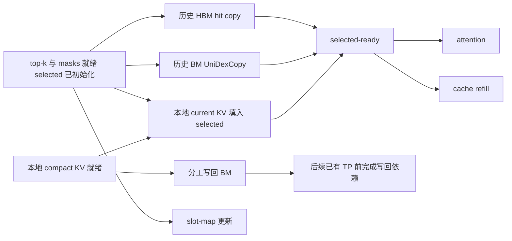

# NUMA 共享：分组配置、组件对照与 MLA 并行路径

2026-10-12。依据用户对[交付计划](delivery-plan.md)的修订：先比较两个独立池与
一个共享池的双 rank 同时读写，再接入尽量重叠的 MLA 路径。本文细化
[规格](spec.md)，描述待实现、待 NPU 验证的设计；没有预设共享或增加 stream 一定加速。
2026-10-14：01组件实验已扩展到TP1/2/4并由用户接受关闭；结果见
[C/D报告](visuals/cd-v1-resume2/report.html)。第1节保留原双 rank 对照设计，
新C/D的固定形状、等总字节和读取口径以[运行合同](../../ascend-mempool-test/NUMA_CD.md)为准。
物理NUMA落点仍unverified；02/03的真实模型路径尚未实施。
current KV 填入 selected buffer 与历史 UniDexCopy 独立并行提交；
写回允许覆盖同一 decode step 的下一层 attention，step 结束前收齐，不跨 token。

## 0. 先分配 NUMA，再决定池的共享方式

这是2026-10-14的生产接入设计，以下新选项尚未实现。
部署默认每个 NUMA 两个 TP ranks，分组代码按实际成员列表工作。
“可调节”指启动时配置 NUMA 分配与共享开关，重启后生效。

### 配置与兼容

- 拟新增 `SGLANG_NPU_MEMPOOL_SHARE=0|1`，内部统一为 `mempool_share`。
  未设置时取0，保留旧启动的独立池行为；新共享部署模板显式取1。
- `SGLANG_NPU_MEMPOOL_LOCAL_NUMA_NODE` 是不重复的节点列表。2026-10-22用户
  改为按每台主机内rank升序连续均分，替代轮转。4个ranks使用`0,2`时分配为
  `0,0,2,2`，同节点成员是`{0,1}`与`{2,3}`。不能整除时前面的节点多分一个rank；
  节点多于ranks时只用前若干节点。TP16配8个节点时才是每节点两个ranks，不写死组大小。
- 自定义布局提供显式 `rank_numa_map` 输入，按主机和全局TP rank覆盖完整本机
  成员。允许多个rank取同一节点，但重复rank、遗漏rank或非法节点明确失败。
  同时提供旧列表和显式映射时明确报冲突，避免隐含优先级；CLI拼写在02实现时确定。
  两种输入都先产生统一的最终分配，share只处理该结果。
- share=1要求每个成员节点已明确解析。旧自动节点占位值`-1`或无效配置的
  fallback不能用作共享组键。share=0沿用既有NUMA行为；非法share值两模式均失败。

### 分组与物理存储

按同一模型/TP实例、PD侧、物理主机身份、已分配NUMA及兼容KV布局形成候选组。
不同主机的node0不是同一个节点；成员必须存储等价的完整compact KV。
共享开启时候选组就是共享组，关闭时每rank单独成组。

| 同一主机的示意分配 | share=0 | share=1 |
| --- | --- | --- |
| rank0→node0，rank1→node0 | 两个完整池 | 一个池，两个成员 |
| rank0→node0，rank1→node2 | 两个完整池 | 两个单成员池 |
| rank0/1/2/3全部→node0 | 四个完整池 | 一个池，四个成员 |
| rank0/1→node0，rank2/3→node2 | 四个完整池 | 两个池，每池两个成员 |

默认配置模板从实际主机/NPU拓扑生成每节点两成员的明确分配，打印结果供核对。
自定义分配决定成员数，不再额外叠加一个容易冲突的“共享组大小”参数。
单成员、双成员、四成员及不均匀组使用同一地址/身份合同；容量按完整逻辑KV
计算，不能因为成员数变化而静默更改token容量。

每组确定一名物理owner（按组内全局TP rank排序取首名），其他成员零贡献；
各进程仍创建自己的SDK handle并建立设备映射。所说“只创建一个mempool”是
一份物理KV存储，不是只有一个进程有handle，也不是由owner代转发所有copy。
组大小g对应P/D共2g个BM participants，身份、端口和probe按组规划。
复用01已验证的有序关闭：全员设备drain→pool close→客户端退出→Store owner最后退出。

P/D按逻辑TP成员集合匹配组，物理主机与节点编号不要求相同；两侧模式、分组、
布局及writer规则须一致。先校验完整计划再分配，并在准入握手核对identity；
不匹配时携带rank/group诊断失败。每个成员保留稳定映射供Graph capture。

### 写入、读取与验收边界

g成员共享一份逻辑KV，写入按无重叠规则覆盖一次；bulk优先复用01的连续行分工。
均匀bulk时每rank约写1/g，余数明确归属；单token可只有一名writer，其他成员零写。
小粒度是否采用feature等分工由02/03实测选择，不为了“每人都有写”而引入重复写。
每个reader仍取完整top-k数据到自己的HBM，组内读取流量不会自动除以g。

CPU从公开配置到最终分配/identity、writer覆盖及生命周期验证外部行为。
NPU组件入口驱动生产manager验证g=1/2/4；真实GLM-5.2仍按TP16和默认双成员组
验证请求全流程。01已有benchmark结果复用，新接入、Graph依赖和实际模型内容
必须重新验证。配置落点与物理页证据分开记录，缺失证据仍为unverified。

## 1. 第一阶段先回答带宽问题

### 固定拓扑与口径

选择同一 NUMA 对应的两张 NPU，在两种模式中保持 NPU、CPU/NUMA 亲和性、SDK、
copy 实现、逻辑 KV 内容、有效索引、HBM 输出、Graph 形状与运行顺序一致。

| 模式 | 每侧物理存储 | 访问者 | PD session |
| --- | --- | --- | --- |
| independent | 两个完整 allocation，各存一份相同逻辑 KV | rank a/b 各访问自己的池 | 两个现有 P_i/D_i session |
| shared | 一个完整 allocation，另一个 rank 零贡献 | rank a/b 直接映射同一池 | 一个 P_a/P_b/D_a/D_b session |

两侧分别落在各自指定 NUMA。先在一组上完成可信比较，再复测实际使用的 NPU
配对；TP16 八组共同运行的系统瓶颈由真实服务验收。owner 仅负责物理贡献，
所有计时访问均由相应 rank 的 NPU 直接执行。

定义 `L` 为一个逻辑任务的一份有效 KV 字节数，`W` 为等字节实验中每个 writer
提交的字节数，`R` 为每个 reader 实际需要的完整 selected KV 字节数。copy 请求
字节数由有效 rows/spans 计算；它不等于含缓存、重复 transaction 和协议开销的
物理总线流量。有硬件计数器时另外报告实测流量，不混用名称。

### 必测对照

| 实验 | 两个独立池、两个 ranks 同时执行 | 一个共享池、两个 ranks 同时执行 | 回答的问题 |
| --- | --- | --- | --- |
| 等逻辑任务写入 | 每 rank 写完整 `L`，合计 `2L` | 分别写互斥分片，合计 `L` | 减少重复写能节省多少任务时间 |
| 等 copy 请求字节数写入 | 每 rank 写 `W`，合计 `2W` | 每 rank 写 `W` 到互斥范围，合计 `2W` | 同一 allocation 是否降低并发效率 |
| 完整 selected KV 读取 | 每 rank 从自己的副本读 `R` | 每 rank 从共享副本读 `R` | 合计 `2R` 读取时共享带宽是否受限 |
| 现有 decode 顺序 | 完整写新 KV，再各自读取 | 分工写新 KV，再各自读取 | 当前调度下的 materialization 总成本 |
| 历史读与新 KV 写重叠 | 各自读历史、写完整新 KV | 各自读完整历史、分工写新 KV | 读写争用是否抵消去重收益 |

等字节写入实验保持总 active destination bytes 相同，shared 的互斥范围相应
扩大；它是并发效率诊断，不拿该实验的 allocation 大小计算服务去重率。
等逻辑实验则保留实际布局差异。共享读取时绝不能让两个 ranks 各读一半：
每个 rank 都要在自己的 HBM 得到完整结果。单 writer/reader 仅作诊断参照，
不能替代双 rank 同时运行的主结果。

写入覆盖 prefill bulk、多请求 token/block，以及 decode 单个 compact row 的
小粒度。当前 GLM-5.2 BF16 compact row 为 `576 × 2 = 1152 bytes`。单请求按
token/block 分工时当步可能只有一个 writer，必须如实报告；双 writer 的小粒度
span 对照只有在相应 copy/layout 实际支持时才测，不用 bulk 数字推断其性能。
候选按 token/block、layer、feature 比较，保证分片边界、尾部、对齐和完整性。

读取至少覆盖本地 D 历史、远端 P prompt、P/D mixed；各模式使用相同有效 top-k
和索引分布，分别报告连续／离散访问、缓存命中率、工作集、有效数据量。
包含真实的大于 index_topk 的历史范围；不能把宽度 2048 而只有几个有效元素的
正确性 case 当作 2048-token 带宽测量。zero-valid/all-hit 是控制或正确性 case，
BM 有效字节为零时不计算 BM 有效带宽。
先测全 miss，再补固定命中率或真实 trace；重复 replay 不能悄悄把 BM 测量变成
HBM cache 测量。单 rank 诊断分别交换 owner/follower 的访问 NPU，暴露映射与亲和性差异。

区分两层观察：纯 BM copy 测共享 allocation 的访问能力；实际 KV materialization
测 metadata、HBM hits、P/D misses 和 refill 的组合成本。后者保留当前 P/D miss
顺序，不借本票提前实现原 ticket04 的 P/D miss 双 stream 改造。

### 计时与结果

- 提前完成分配、映射、内容初始化和暖机。先校验内容再采样，采样后复验；
  不将 sentinel fill、日志输出或结果搬回 CPU 混进纯 copy 时间。
- 测量前用控制同步对齐双 rank 的批次，同步放在计时区外。记录提交偏差和设备
  完成，确保两者确实并发；Python enqueue 返回时间不能当 copy 延迟。
- 每 rank 用设备计时和完成事件测量；组完成时间按同一轮两个 rank 的完成包络
  计算，同机 host monotonic 的 `max(done_i)-min(start_i)` 与 per-rank device
  duration 分开报告；不直接相减两张 NPU 的 event 时间戳。
  仅在起点对齐已验证、偏差可忽略时用 `max(T_a, T_b)` 近似设备执行包络。
  跨主机不能相减未经校准的时钟；写入、读取每个方向在消费者所在主机计时。
- 逻辑写入速率为 `L / T_group`；copy 请求带宽为实际提交的有效字节总和除以
  `T_group`。读取两种模式都是 `2R / T_group`。不能相加两个 rank 的独立峰值
  吞吐冒充同时运行的共享池吞吐。
- 分别报告 per-rank 与 group 的 P50/P95、实际字节、长尾、并发效率、原始样本。
  eager 与 Graph 分开，暖机后交替 A/B 多轮。Graph 的 device 时间和包含 replay
  提交的批次时间分别报告；极小拷贝通过重复批次降低计时扰动。
- 矩阵先选代表性小/中/bulk case，并扩展发现差异的维度，不堆没有有效数据的
  全排列。profile 取样与正式计时分开，避免 profiler 开销进入最终对照。
- 记录 copy kernel 的 block_dim、有效 mask 与分片分布。UniDexCopy 通过
  GM→UB→GM 搬运，稀疏 mask 可能改变活跃 core 分布；简单 mask 掉半份工作
  导致的负载不均不能一律归因于共享 DRAM。真实路径还需计入 compact KV
  打包、metadata 和 cache/refill 开销。

01 的验收包含正确性、物理去重以及上述双 rank 读写报告。用户审阅瓶颈和可用的
写入/调度候选后才解锁02。最终服务容差仍是吞吐、ITL P50/P95 各最多 3% 回退；
不凭空新增“每个大小的微基准必须过 3%”门槛，也不因 bulk 写得快而忽略读取瓶颈。

## 2. 第二阶段把共享写移出不必要的串行依赖

### 最早可提交点

GLM-5.2 普通 DSA prepare 在 compact KV 完成 norm、RoPE 和必要重排后调用
indexer，源码见[NPU DSA module](../../python/sglang/srt/hardware_backend/npu/modules/deepseek_v2_attention_mla_npu.py)。
当前写入发生在 indexer 返回后的[attention backend](../../python/sglang/srt/hardware_backend/npu/attention/ascend_backend.py)。
仅在原 backend 调用处换 stream 只能覆盖后面的 fetch/attention，不能覆盖 indexer。

因此候选实现提前到完整 compact KV 已就绪的位置提交分工写入：先准备不依赖
top-k 的 slot、logical position、writer mask 与源地址，再记录 `compact_ready`。
write stream 等该事件后直接写所属分片，完成后记录 `write_done`。提前提交
替换旧写入；backend 消费同一层的写入凭据并继续检查边界，不能再写一遍。
这里的 `compact_ready` 是本地 source 事件，与 PD 协议的 KV_READY 无关。
每个 rank 复用一条持久 writer stream，不按 layer 创建 stream；现有 compact
source 打包和 metadata 成本要进入调度对照，不能只测后面的 copy。

### selected buffer 的并行填充

本地有 current KV 不等于 selected buffer 已经有它。current-fill 是一条真实的
HBM copy 路径，需与读取其他 top-k 的 UniDexCopy 独立提交；selected-ready
只汇合这次 attention 所需的 copy，不等待新 KV 写回 BM。

图中 H/M/C 是三种来源。独立 current stream 可使 current-fill 与历史 hit/
miss 两条路径都无相互等待；attention/refill 各汇合三个完成事件。另测复用
hit stream 的候选：它顺序执行历史 HBM hits 与 current-fill，和 BM miss
并行，可减少一条 stream/event，但不能声称与全部历史 copy 都并行。
两种组织都纳入实测，以 selected-ready 和端到端耗时选择，不预设更多 stream 更快。

两路 copy 的公共 ready 事件只覆盖 selected 初始化、top-k、binding、历史
可读范围和 masks；不能在记录它之前先做 current-fill 或等待 BM write_done，
否则又会把 UniDexCopy 串在后面。selected 的清零必须早于所有填充，不能与
copy 并行后覆盖已经写好的数据。原有 attention 返回前的 refill/map 完成保护
保留。历史 hit/miss/current 分别写互斥 destination rows，不需要互斥锁。

### 写回覆盖下一层 attention

用户已明确“下一个 attn”指同一 decode step 的下一层。第 L 层 current KV
服务本层 attention 后，同一步的 L+1 层读取的是 L+1 层自己的 KV；GLM-5.2
共享 top-k 只复用索引，不复用各层 compact KV。因此写回 L 不必挡住 TP(L)，
可以延续到 attention(L+1)，并在 TP(L+1) 前接入它的完成事件。

| 位置 | 计算路径的写回等待 | 可以继续运行的写回 |
| --- | --- | --- |
| TP(0) 前 | 没有上一层写回需要等待 | write(0) |
| 普通 TP(L) 前，L≥1 | 等本 rank 的 write(L−1) 完成 | write(L) |
| 最后一层 TP 前 | 收齐所有剩余写回，包括最后一层 | 无跨 step 的剩余写回 |

**关键顺序：** write(L) 完成 → 本 rank 接入已有 TP(L+1) → readers 完成该
通信的设备依赖 → 后续可从 BM 使用 L 的这份历史 KV。最后一层使用尾部已有
TP 收齐。通信组必须覆盖共享组所有 writers，BM 可见性仍由 NPU 验证。
本层 TP 并不自动表示本层写回已发布，written/published 状态需按层区分。

必须等待具体的 `write_done[L−1]`，不能在 TP(L) 前 `wait_stream(writer)`：
后者会把已经提交的 write(L) 也一起等完，消除跨层窗口。首版只滞后一层，
当前 step 在末层边界完成；保留同层 join 作为性能对照。如果写回比下一层
attention 还慢，仍会有剩余等待，不能预先保证零开销。

### 两组源与 metadata 交替复用

write(L) 与 attention(L+1) 重叠时，L 的 compact source 及 write metadata
必须继续存活，不能被 L+1 覆盖。对现有单执行 stream 的模型顺序，先用两组
staging 交替管理：L 与 L+1 各占一组，生成 L+2 前已通过 TP(L+1) 并完成
write(L)，才复用 L 的一组。local current-fill 在本层 attention 前已经完成。

两组覆盖 source、slots、positions、valid/mask 和需复用的 route scratch。
设备完成事件按 forward/layer 身份管理，不能重新记录仍有旧消费者依赖的事件。
固定 Graph buffers 同样遵守复用次序，不用 host polling 控制 replay。

当前 mempool 已不支持 two-batch overlap；普通 scheduler overlap 保留。
CPU 可以提前提交多个 forward，关键是设备上的 tail flush 必须排在下一次
scratch 复用之前，不要求 CPU 同时只能有一个 pending receipt。未来若使用
多个并行执行 stream，需为各执行身份隔离租约，不能共享两个未保护的全局槽。

### 当前 token、本地 cache 与 buffer 所有权

1. top-k 中当前 forward 的新 token 从本 rank 的 `k_nope/k_pe` 供给，历史 token
   才走 cache/BM；按每个请求的实际 logical position 分类，不能假设新 token
   是 selected 数组的最后一项。未选中新 KV 仍写共享池供后续步骤使用。
   每个 selected destination 为 `batch_row * K + selected_column`；current
   source row 用 batch row，不用 request pool index。重复选中 current 时
   填满所有对应 destination，padding/unbound rows 沿用有效行检查。
2. current、历史 hit、历史 miss 的 destination masks 互斥且完整，padding 和
   无效项屏蔽。current-fill 独立提交，历史 copy 不等待其完成；比较独立
   current stream 和复用 hit stream，两者的实际并行范围分别报告。
3. attention 等 selected KV 的所有实际来源；refill 也必须等它要读取的 selected
   KV 就绪。复用 hit stream 时沿用 hit/miss 两个完成事件；若启用独立 current
   stream，则两处消费者额外等待 current_done。slot-map 只等自己的 metadata。
4. 独立 write stream 使用自己的固定 metadata/scratch。源 KV 由生成方保留到
   写入完成及本地消费者完成，eager 保持跨 stream 的 allocator 生命周期，
   Graph 保持稳定地址。复用 metadata、compact KV 临时区和 request binding
   前必须等最后一个消费者，而不是只等 Python 调用返回。
   现有 attention 入口的 k/k_rope 虽各自连续，但不是一块 576 维 row。优先
   复用一次打包的 compact source 供 current-fill 和写回同时读取；不能把
   stride 仍为 576 的 selected 子视图冒充连续 512 或 64 维目的 buffer。
5. 将实际 writer 的分片覆盖、本地新 KV 可读范围和共享历史完成范围分别表达。
   本 rank 只写半份不能报告自己写过完整 prefix；CPU 提交计数也不等于设备完成。
6. drain/cancel/release 必须纳入 write stream、selected KV 消费及 refill；
   owner 不得因自己的写入完成就提前释放共享 allocation 或 slot。

### 分开比较 selected 填充和写回调度

先固定存储和写回策略，对比 current-fill 与历史 BM copy 串行／并行的
selected-ready 延迟，并验证两路实际重叠。再固定 selected 并行路径，比较
以下写回调度，避免把 current-fill 的收益误记为写回流水的收益。

| 候选 | 写回提交 | 完成边界 | 用途 |
| --- | --- | --- | --- |
| A | 当前 backend、producer stream | 本层 attention 前 | 共享模式的串行写回对照 |
| B | 当前 backend、独立 write stream | 本层 TP 前 | 单独测引入 stream 的收益与成本 |
| C | compact ready 后提前提交，独立 write stream | 本层 TP 前 | 比较提前提交的收益 |
| D | 与 C 相同 | 下一层 TP 前，末层收齐 | 比较覆盖下一层 attention 的收益 |

各候选必须使用相同共享布局、writer 策略和 selected 填充路径，以隔离调度
差异；另外保留原独立池端到端基线。默认策略由实测决定，不按“stream 更多”选择。
B/C 可作为诊断配置，不要求长期维护四个公开运行模式。
GLM-5.2 的 21 个 producer 层与 57 个 shared-topk 层分别出数据：后者没有本层
indexer 窗口，小 batch 的事件/metadata 成本可能抵消收益。Graph 中策略由静态
层/捕获配置确定，不以 host polling 改写 replay 路径。

timeline 需分别标出 current-fill、历史 UniDexCopy、selected-ready、compact-ready、
各层 write 起止、indexer、attention/o_proj、下一层 TP 前剩余等待、尾部 flush
和总 layer/step 时间；同时报告读写与计算资源争用。用延迟 writer 验证本层
selected 供给和下一层 attention 不被提前等待挡住，而复用/下一 step 历史
读取确实受发布依赖保护。性能报告不只给一张“有重叠”的截图。

shared-topk 层还可能提前取得历史 token 索引，但把历史预取提前到 Q/K projection
之前需要另改 fetch/readability 合同。首版先测上述最小并行路径；只有 timeline
证明必要才扩展，不能靠引入跨步队列掩盖未解决的写入发布依赖。

### P 侧 prefill 与 handoff

P 原生 HBM KV 继续服务 prefill attention；BM 写入只读已就绪 compact KV，
可与 native HBM 写入、后续计算及可独立启动的 Index K/state 传输重叠。
每次 source buffer 复用前完成对应 copy，pending 总量受 forward/chunk 边界
约束；完成快照必须记录在实际 writer stream 的 copy 之后。

不为每层新加 TP barrier；沿用现有全 TP ready 汇合，在所有 prompt 分片完成
后发布 KV_READY。native handoff 和 BM-ready 可以分别推进，D 的 admission
仍同时需要 matching KV_READY 与 native transfer success。取消、结束与 P slot
释放覆盖两条路径，不能因其中一条先完成就回收源或共享存储。

## 3. Graph、验收与实现入口

Graph 需要捕获真实 write-stream fork/join、稳定 source/metadata、current-token
填充和历史读取。覆盖 zero-writer、zero-valid、padding、连续 replay、slot 与
generation 切换；写入目标按稳定 device metadata 更新，不能冻结 capture 时的
请求信息。不得用 `.item()` 或 replay 时不再执行的 Python 分支选择写入。
D 的 forward completion snapshot 位于 captured 尾部 flush 后；P 的完成记录
则跟随实际 writer stream。正常快路径不能依赖异常 drain 的全设备 synchronize
补救未接好的事件。部署 CANN/torch_npu 对跨 stream capture 的支持属于硬件验收项。
跨层验证覆盖首层无前驱、普通层等待前一层、末层收齐、交替 staging 复用、
连续异步提交多个 forward、取消/错误时全部 pending writes 的 drain。NPU
Graph replay 不执行各层 Python 回调，完成边界与 buffer 身份必须落在捕获图中。
尤其尾部 flush 必须在被捕获的模型内部、最后已有 TP 之前。现有 Python
end_forward 在 capture context 退出后执行，只把等待放在那里不会自动使
等待进入 Graph，也不能建立所有 ranks 的尾部发布次序。

代码定位依据为 `cc10a7b794`：

- [runtime](../../python/sglang/srt/hardware_backend/npu/mempool/runtime.py)：目前
  write、written-range、fetch 与 write-event snapshots 的耦合需要拆开。
- [offload](../../python/sglang/srt/hardware_backend/npu/mempool/offload.py)：复用
  稳定 route buffers 和实际 copy 路径，按候选分片扩展，验证对齐与边界。
- [sparse manager](../../python/sglang/srt/hardware_backend/npu/sparsity_driven_kv_offload/manager.py)
  与[attention](../../python/sglang/srt/hardware_backend/npu/sparsity_driven_kv_offload/attention.py)：
  current/hit/miss 分类、selected KV、refill 和 scratch 的最后消费者。
- [decoder](../../python/sglang/srt/models/deepseek_v2.py)与
  [communicator](../../python/sglang/srt/layers/communicator.py)：接入已有 TP 前的
  本地 write completion，保持其他平台和独立池路径兼容。
- [control tick](../../python/sglang/srt/disaggregation/ascend/mempool_tick.py)：
  保留 native/BM 两种 readiness 与全 TP 生命周期。
- [现有独立 gate](../../ascend-mempool-test/README.md)：复用自运行与报告框架；
  现有功能 gate 的计时和有效元素数量不能直接替代本次性能实验。

02 必须交付并行路径正确性与 timeline/耗时对照，不能只做到“能运行”后把全部
并行设计推给03。03 在此基础上完成写入粒度和调度选择，以及最终同负载 3% 验收。
所有 NPU 测试由用户运行，一台主机一个自运行入口，日志保存至 `/home/cryang/log/`；
阶段完成遵循[既有验收流程](../ascend-mempool/verification.md)。
